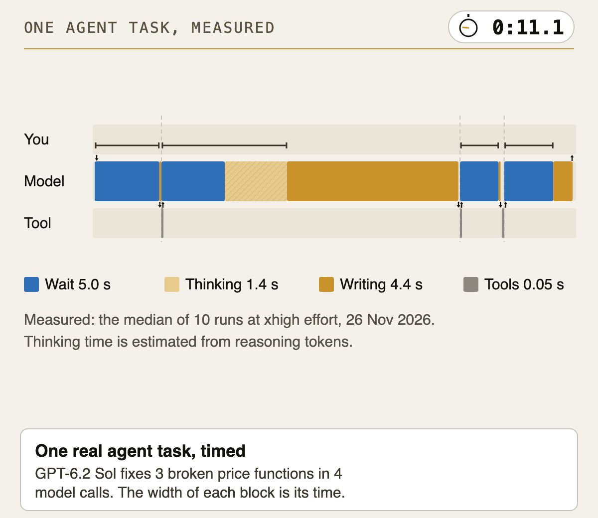

# agent-latency-trace

**I built this to see where the time goes when an AI agent works on a task. The script
runs a small coding agent and times every model call and every tool. All the raw logs are
in this repo. You can check each number below without an API key.**

The agent works on a small checkout module with 3 broken functions. It calls the model
through OpenAI's Responses API and has 3 tools: read a file, edit a file and run the tests.
The API streams each reply in small pieces, called events. For each model call, the script
saves the time each event arrived. It also saves the token counts the API returns: input,
cached input, reasoning and output. Reasoning tokens are hidden tokens the model writes
before its visible reply. The API reports how many there were but does not send them. We
worked out every measured number below from these logs, in `data/raw/` for the 20 runs
and in `data/pilot/` for the pilot.

This repo goes with my article *Why Is Your AI Agent So Slow?*. The article will be on
[Medium](https://medium.com/@net_satsawat) soon.



*One of the 10 runs at xhigh effort. It is the 5th fastest, at 11.1 s, just under the
median of 11.2 s. The width of each block is how long it took.*

## What we found

We timed 20 runs of GPT-6.2 Sol on 26 November 2026, 10 at medium effort and 10 at xhigh.
Effort is an API setting. A higher level lets the model write more reasoning tokens before
it replies, and xhigh is the level above high. We switched the effort level after every
run. Every run passed the tests.

The table shows the median of each number. For task time, the numbers in brackets are a
95 percent bootstrap interval. We resampled the 10 runs 5,000 times and took the median
each time. The middle 95 percent of those medians fall in that range. For the 3 share rows,
we added up each kind of time over all 10 runs and divided it by the total task time of
those runs.

| | medium | xhigh |
|---|---|---|
| task time | 9.3 s (9.0 to 9.9) | 11.2 s (10.9 to 11.8) |
| model calls per task | 5 | 4 |
| wait for the first token, per call | 1.08 s | 1.34 s |
| writing speed | about 95 tokens a second | about 100 tokens a second |
| reasoning tokens per task | 0 | 137 |
| share of the task spent waiting for first tokens | 61% | 60% |
| share spent writing | 37% | 38% |
| share spent in tools | 0.6% | 0.5% |
| cost per task, estimated from list prices | $0.0049 | $0.0087 |

[results/summary.md](results/summary.md) has the full table, with an interval for every
median.

**1. Most of the time went to waiting for the first token of each call.** On a call with
no thinking, the first token came back after about 1.1 s. The agent made 4 to 6 calls per
task. In each call, the model wrote between 14 and 398 visible tokens, the tokens you see
in the reply. Hence waiting for first tokens took about 60 percent of the task time,
including the thinking. Writing took 37 to 38 percent. At xhigh, thinking took about 2 s
of the 6.8 s that a task spent waiting for first tokens. The 2 s comes from 137 reasoning
tokens at about 15 ms each (see point 3).

If your agent's task has many short steps, cut the calls that only fetch something. Each
one you cut saves a wait of about 1 s here. For example, ask the model to read files that
do not depend on each other in one step. We ask for this in the agent's system prompt. In
all 20 runs, the model asked to read both files in its first call. We did not time the
agent without this instruction. Fewer calls do not always mean a faster task. At medium,
the 4 runs that finished in 4 calls took 9.6 s at the median, against 9.0 s for the 4 runs
with 5 calls. In those 4-call runs, the model wrote all 3 fixes in one bigger edit.

**2. At xhigh, the task took longer, even with fewer calls.** At xhigh the model fixed all
3 functions in 1 edit in every run, so it always finished in 4 calls. At medium it used 1
to 3 edits and 4 to 6 calls. Still, xhigh took longer in all 10 pairs of runs. Each pair is
the medium run and the xhigh run with the same run number. At the median, the xhigh run
took 2.0 s longer, with an interval of 0.8 to 2.6 s. Even in the 4 pairs where medium also
finished in 4 calls, xhigh took longer. At medium, the model wrote no reasoning tokens on
this task. Every run passed at both levels. So raise the effort only if you see more of
your tasks pass at the higher level.

**3. Thinking is part of the wait. Each reasoning token took longer than a visible token.**
The API sends no thinking text and no start time for it. It reports the number of
reasoning tokens in the `usage` block of each reply. To estimate the thinking time, we fit
a straight line of the wait against the number of reasoning tokens. Each reasoning token
added about 15 ms to the wait. The thinking speed comes out at about 66 tokens a second,
with an interval of 60 to 72. The model wrote visible tokens at about 95 to 100 tokens a
second. Only 10 calls had any reasoning tokens. So treat the 66 tokens a second as a rough
estimate.

**4. OpenAI cached the system prompt only when we put it first in the input.** Before the
20 runs, we did a few small test runs, which we call the pilot. In the first pilot, we put
the system prompt in the top-level `instructions` field. No call got any cached tokens, for
2 reasons. First, according to OpenAI's prompt caching guide, the API adds `instructions`
after the input on GPT-6.2 models. The cache only covers the start of the input, so
`instructions` falls outside it. Second, OpenAI only caches the start of a prompt, called
the prefix, when it is 1,024 tokens or longer. Our input without the system prompt was
shorter than that.

Then we moved the system prompt to the start of the input, as a `developer` message. From
then on, almost all of the input came from the cache, the first call included (1,484 of
1,487 tokens). Over all the calls after the first, 99 percent of the input came from the
cache at medium and 92 percent at xhigh. The lowest single calls came right after the edit
at xhigh, at 77 to 80 percent. Their input held the long edit the model had just written,
which no earlier call had sent.

**5. The tools took almost no time.** Reading a file, editing it and running the tests took
milliseconds each. Our tools run on the same machine as the agent. In your own agent, tools
that call a network or a database will take a bigger share of the task time.

## What each number means

The script sends each call, waits, then reads the reply as it streams in. It saves the time
of every event and the `usage` block the API returns. [analyze.py](analyze.py) turns these
into the numbers below.

- **wait for the first token:** the time from sending the request to the first visible
  output, either text or the start of a tool call. It includes the network, the provider's
  queue, reading the part of the prompt that is not cached, and any thinking. There is one
  problem with this measure. When the model asked for 2 tools in one call, both tool calls
  arrived at the same moment. So the time the model spent writing them also counts as
  wait. We estimate this adds about 0.5 s to the first call of each run, from 51 tokens at
  about 98 tokens a second. The 0.5 s is about 5 percent of the task time.
- **reasoning tokens:** `usage.output_tokens_details.reasoning_tokens`. The model writes
  these tokens before its first visible token, so their time is part of the wait.
- **writing speed:** visible tokens (output tokens minus reasoning tokens) divided by the
  time from the first visible token to the last. We leave out calls under 20 visible tokens
  or 0.25 s, because they are too short to time.
- **cache hit rate:** `usage.input_tokens_details.cached_tokens` divided by all input tokens.
- **tool time:** from the moment a tool starts to the moment its result is ready.

## Check the numbers without an API key

```bash
git clone https://github.com/netsatsawat/agent-latency-trace
cd agent-latency-trace
make check
```

`make check` runs the tests. Then it works out every number in `results/` again from the
raw logs and compares them with the files in `results/`. If any number comes out different,
the check fails. You only need Python 3.9 or later. Our CI job runs the same 2 steps on
every pull request and every push to main.

## Run it yourself

```bash
export OPENAI_API_KEY=...
python3 trace_agent.py --task checkout --model gpt-6.2-sol --efforts medium xhigh --runs 10 --max-cost 5
python3 analyze.py data/raw/<your file>
```

Our 20 runs cost about $0.14 at list prices and took about 3.5 minutes. The `--max-cost`
cap is for all the runs together. The script checks it before each model call, so the total
can go over the cap by the cost of 1 call. Your numbers will differ with the model, the
effort level, the time of day and where you run from. So time your own agent first, then
decide what to change.

Each time you run `trace_agent.py`, it writes a new file in `data/raw/`. By default,
`analyze.py` reads every file in that folder. To keep your runs apart from our 20, pass your
own file, as in the last line above. `analyze.py` then writes the tables to
`out/<your file>/` and does not touch the committed `results/`.

The default prices are GPT-6.2 Sol's, in US dollars per million tokens: $2.50 for uncached
input, $0.10 for cached input and $10 for output. The $2.50 is Sol's 30-minute cache-write
price, which is above its $2.00 input price. We use it so the cost estimate comes out a
little high, never low. If you change `--model`, pass that model's prices with
`--price-input`, `--price-cached` and `--price-output`. Use its cache-write price for
`--price-input` to keep the same rule.

There is a second task, `--task billing`, with date bugs to fix. In 1 pilot run each at
medium and high effort, the model wrote no reasoning tokens on it. We did not run it at
xhigh.

The tests run code that the model wrote. On macOS, the script runs the tests under
`sandbox-exec`. The sandbox blocks the network and allows writes only inside the run's own
temporary folder. On other systems, the script runs the tests with no sandbox. Run it there
inside a container or a virtual machine you can delete afterwards.

## Files

| path | what it is |
|---|---|
| [trace_agent.py](trace_agent.py) | runs the agent and saves every call, standard library only |
| [analyze.py](analyze.py) | turns the raw runs into `results/`, with `--check` for CI |
| `tasks/checkout/`, `tasks/billing/` | the small projects the agent fixes, as we ran them |
| `prompts/` | the system prompt and the task prompts, as we sent them |
| `data/raw/` | one JSON line per run: every event time, the usage data, the tool times |
| `data/pilot/` | the pilot runs, from before the changes listed below |
| `results/` | the summary, and the trace of one middle run for each effort level |
| `tests/` | offline tests, including one that checks `results/` against `data/raw/` |

The script saves the time and size of every streamed event. It does not save any text the
model wrote.

## Changes after the pilot runs

We changed 3 things after the pilot runs. Their logs are in `data/pilot/` if you want to
check.

1. In the first pilot, we used an earlier version of the checkout task that had only one
   bug. We put the system prompt in `instructions`, and no call got a cache hit. Point 4
   above gives the 2 reasons. Now we send the system prompt first in the input, as a
   developer message. We also set a fixed `prompt_cache_key`. OpenAI's guide says GPT-5.6
   and later models do not need it for cache hits, so the hits came from moving the system
   prompt.
2. Our first version opened a new connection for every call. Now the script keeps one
   connection per run, as an SDK client does.
3. On the checkout task, the model wrote no reasoning tokens in 1 pilot run each at low,
   medium and high effort. The 10 final runs at medium agreed later. At xhigh, it used 98
   reasoning tokens on the step where it wrote the fix. So in the final runs, we compare
   medium with xhigh.

## Limits

- We tested only one model and one small task, from one location. On a bigger task with
  longer outputs, writing can take a much bigger share of the time. [Yuan and
  colleagues](https://arxiv.org/abs/2605.26297) ran agents on 5 larger benchmarks, with
  open models on their own GPUs and the cache kept warm. In their runs, writing took 91 to
  98.6 percent of the model's time. They count thinking as writing and leave out the
  network, so their split is not the same as ours.
- We did only 10 runs per effort level. Some intervals in
  [results/summary.md](results/summary.md) are wide. For example, the writing speed at
  xhigh is 100 tokens a second, with an interval of 83 to 105, because only 20 calls were
  long enough to time.
- The thinking time in the GIF is an estimate, because the API does not report it. It is the
  extra wait for the first token compared with a call that has no reasoning tokens.
- Costs are estimates from OpenAI's list prices on 26 November 2026.

## License

MIT. See [LICENSE](LICENSE).
